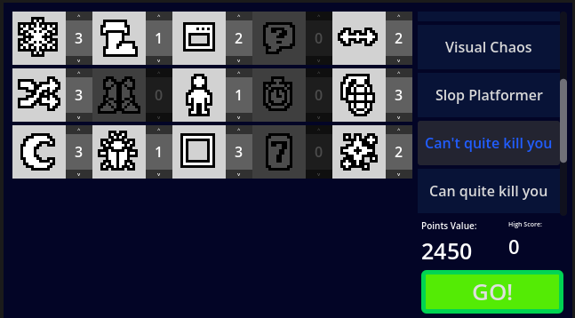
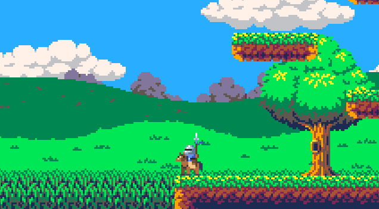

# Ultimate-Custom-Platformer-Game

2D Platformer game where YOU are your own worst enemy. Inspired by "FNAF: Ultimate Custom Night". Mix up to 15 modifiers and make your own unique challenge and have fun (or not).

## Play it in Broswer
[Play it on my itchio here](https://martisos.itch.io)

## Quick Start
- **A S D** (or arrow keys) - to MOVE 
- **W** or(up arrow key) - to JUMP
- **MOUSE** Use it to control everything and to close popups!
- **R** - to reset anytime! (World, death animation, death screen)
- **ESC** - to open options

## Features
- **Customizable Suffering:** - 15 unique modifiers, each has 3 levels of difficulties.
- **Meme Threats** - Avoid immortal snail, close random popups, deal with flashbang cats, don't missclick "Wanna continue playing" windows.
- **Progression system** - Game has some pre-made presets, so try to beat every one of those!
- **Saving system** - Game saves your options, highscore and beaten presets

## How it works
The game is made in Godot 4.7 using GDScript. The game relies on chaos, so the architecture heavily uses signals and global autoloads.

Visual Hazards like glitches, zoom blurs, inverted colors are handled via custom fragment shaders using Color rect. This way the game is absolute mess, but it runs perfectly fine.

## Credits:
- [Player Sprites](https://lyaseek.itch.io/minifhumans)
- [Music](https://hydrogene.itch.io/high-quality-16-bit-music)
- [Tileset](https://shackhal.itch.io/multi-platformer-tileset)
- [Gambling Icons](https://clockworkraven.itch.io/raven-fantasy-icons)
- [Icons in Menu](https://nikoichu.itch.io/pixel-icons)

## How to run locally
- download [Godot Engine (4.7)](https://godotengine.org/)
- open this project in godot editor
- press *f5* and enjot my super awesome game